# NYC Taxi Data Analysis & Visualization

An end-to-end exploratory data analysis (EDA) project using Seaborn's NYC taxi dataset. The project demonstrates practical data inspection, cleaning, statistical summaries, and 10 visualizations using **Python, Pandas, Matplotlib and Seaborn**.

> **Portfolio focus:** turn raw trip records into clear, reproducible evidence about fare patterns, trip distance, pickup locations, tips and payment mix. All numerical findings are calculated from the cleaned dataset when the notebook is executed.

## Project at a glance

| Item | Details |
|---|---|
| Domain | Urban mobility / taxi operations |
| Dataset | Seaborn `taxis` |
| Analysis type | Exploratory data analysis (not predictive modelling) |
| Tools | Python, Pandas, NumPy, Matplotlib, Seaborn, Jupyter |
| Data preparation | Missing-value review, timestamp validation, median/mode imputation |
| Deliverables | Reproducible notebook, 10 analytical charts, key findings report |

## Business questions

1. How does average taxi fare change over pickup dates?
2. Which pickup borough contributes the highest total fare in this dataset?
3. Which payment methods are most frequently recorded?
4. What does the trip-distance distribution look like?
5. How do tip and fare distributions vary across boroughs and payment methods?
6. How strongly are distance, fare, tip, tolls and total associated?
7. How do the most frequently recorded pickup zones compare across numeric trip measures?

## Data preparation

- Load and inspect the Seaborn `taxis` dataset.
- Quantify missing values and visualize their pattern.
- Convert pickup timestamps to datetime and remove records with missing or invalid pickup timestamps.
- Impute remaining numeric missing values with the median.
- Impute remaining categorical/text missing values with the mode.
- Calculate summaries from the cleaned dataset and save a data-backed findings report.

**Data note:** Seaborn retrieves this dataset when first loaded, so an internet connection may be required. Median/mode imputation is an assignment method and can influence distributions and correlations.

## Visualization gallery

Each chart is generated by the notebook and saved in `outputs/`.

| Visualization | What it helps inspect |
|---|---|
| 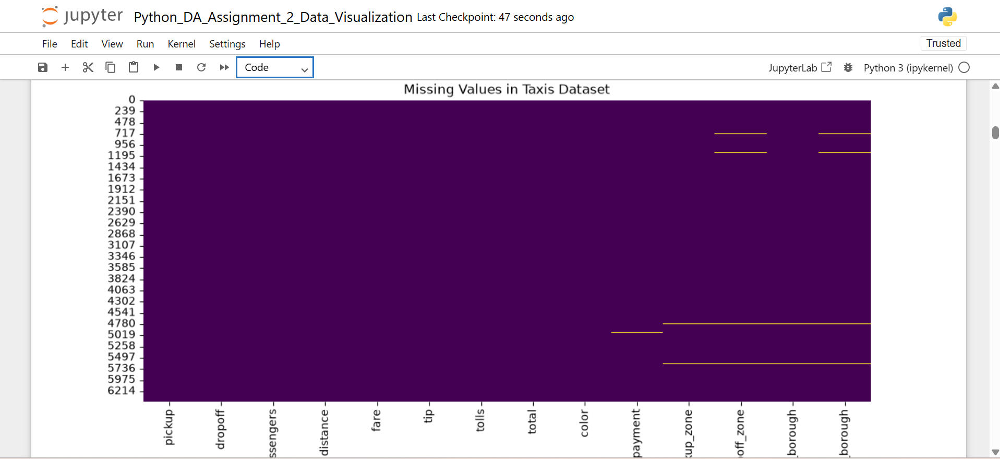 | Missing-value pattern before treatment |
| 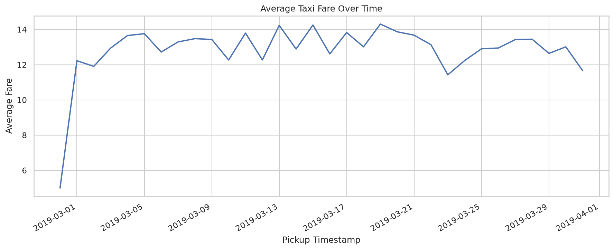 | Average fare by pickup date |
| 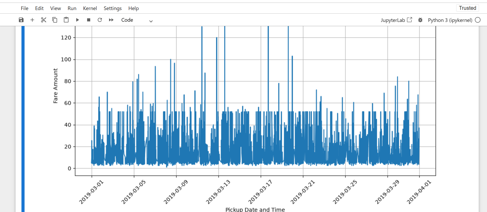 | Sum of fares by pickup borough |
| 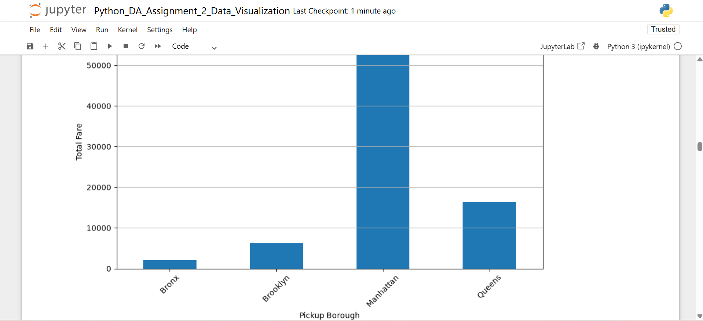 | Share of recorded payment methods |
| 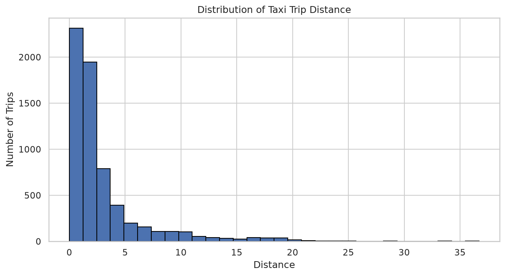 | Distribution and skew of trip distances |
| 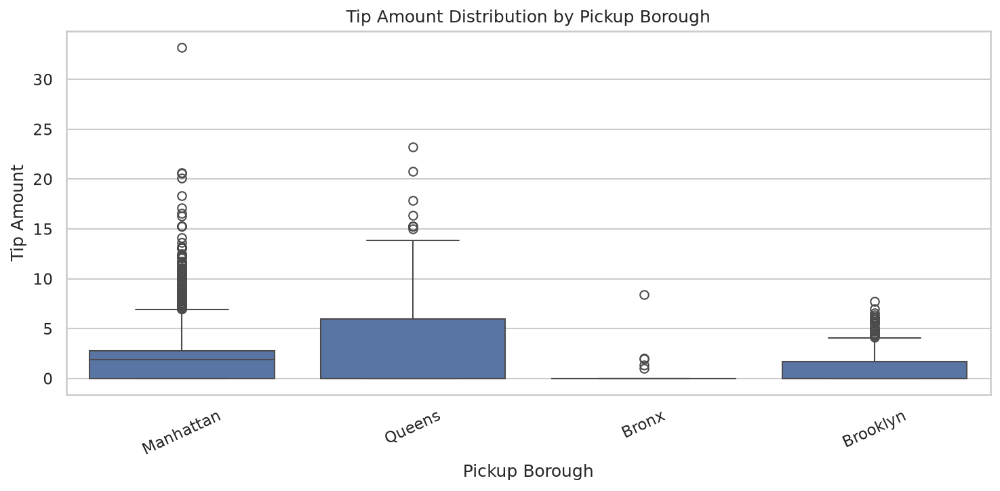 | Tip spread and outliers by borough |
| 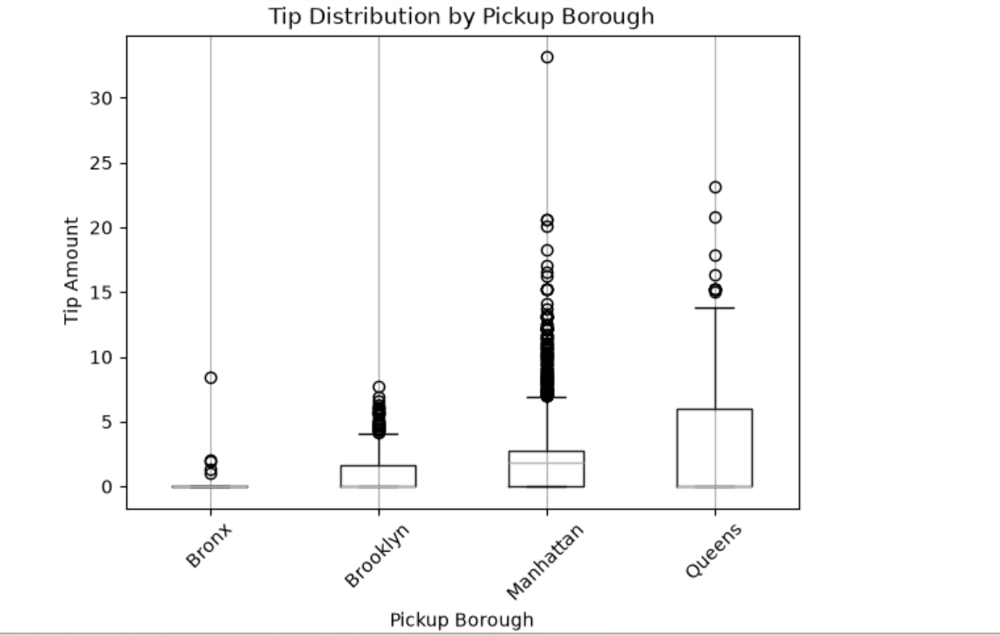 | Trip counts across pickup boroughs |
| 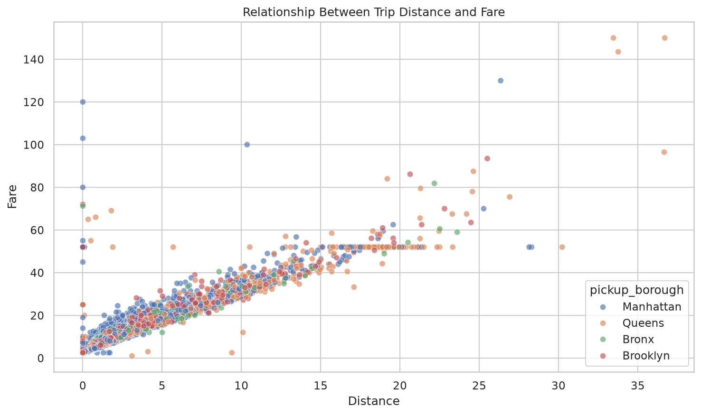 | Distance–fare association by borough |
| 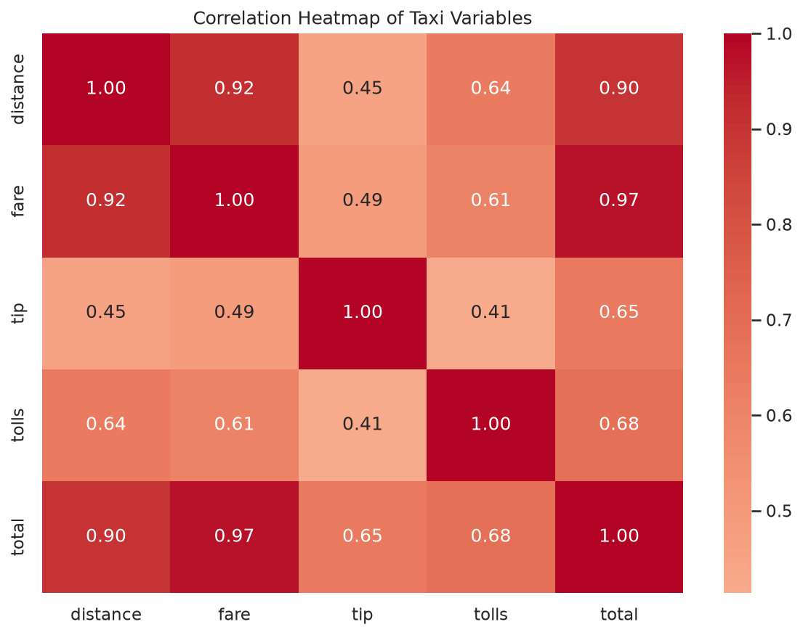 | Pairwise correlations among numeric fields |
| 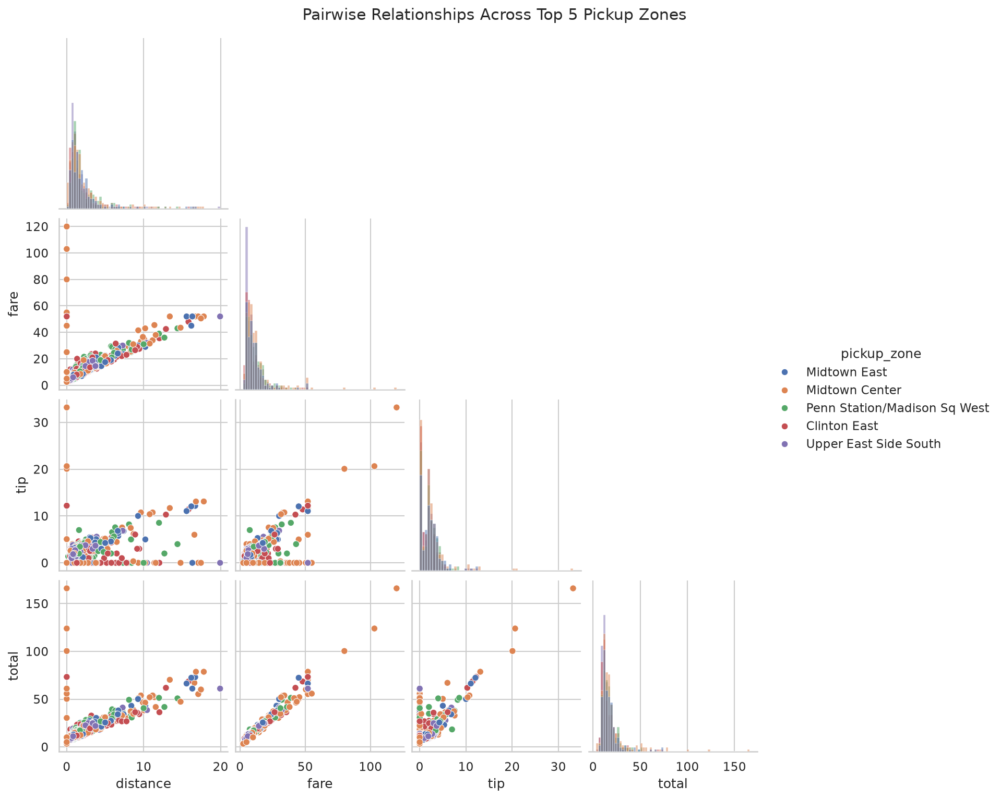 | Pairwise patterns for the five most frequent pickup zones |
| 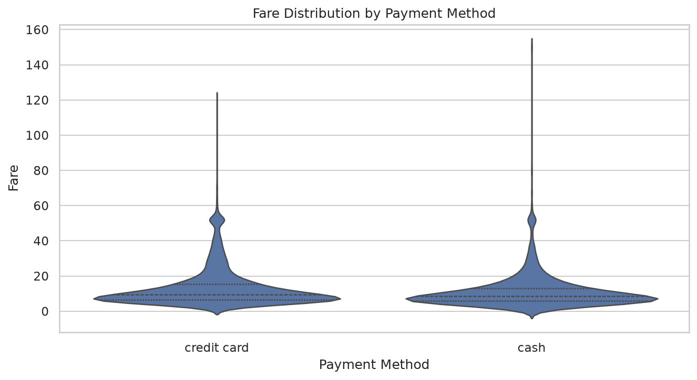 | Fare distribution across payment methods |

## Key findings and business impact

The findings report also compares borough-level trip share, fare share, average fare, median fare, average distance and average tip. Payment-method KPIs compare trip counts, average/median fare and average tips. These metrics help distinguish trip volume from fare contribution and frame operational questions about fleet planning, fare review, payment operations and service quality. They are descriptive indicators, not evidence of profit, savings or causal impact.

## Key findings and business interpretation

Run the notebook from top to bottom to calculate current findings and create **[`outputs/KEY_FINDINGS.md`](outputs/KEY_FINDINGS.md)**. That report includes:
- cleaned trip count and analysis date range;
- median distance, fare and tip;
- borough with the highest total fare;
- most frequently recorded payment method and its share;
- distance–fare correlation and strongest selected numeric correlation;
- top pickup-zone counts;
- practical considerations and limitations.

The figures and report are data-derived at execution time. Avoid copying figures from an old run without regenerating the notebook.

## Business recommendations and next steps

The cleaned sample covers 6,433 trips across four pickup-borough categories from 2019-02-28 to 2019-03-31. Manhattan has the highest total fare in this sample ($59,426.42), 71.8% of trips with a recorded payment method use credit card, and the distance–fare correlation is 0.92. These are sample-level descriptive findings, not live operating conditions.

1. **Study location and time together before fleet planning.** Compare trip share, fare share and time-of-day patterns by borough or pickup zone. Validate any proposed vehicle or driver allocation with current demand, driver supply, wait times and operating costs.
2. **Investigate unusual fare records.** Use distance, tolls and trip context to review outliers, then check applicable fare rules and surcharges before considering a pricing or billing action.
3. **Monitor payment-data quality.** Use the recorded payment mix as a starting point for payment-system reporting, but review missing and unknown payment records before using percentages for finance decisions.
4. **Report volume and value together.** Track trip count, trip share, total fare, fare share and fare per trip. Use medians and distributions alongside averages so a few unusual trips do not dominate the story.
5. **Extend the analysis carefully.** Add weekday/weekend and time-of-day comparisons, then refresh the dataset and generated findings before presenting current operational recommendations.

**Decision boundary:** this dataset does not provide profit, driver supply, vehicle utilisation or wait-time measures. The analysis cannot prove that changing fleet allocation or fares would increase revenue or reduce cost. See [generated key findings and the detailed action notes](outputs/KEY_FINDINGS.md).

## Tools and skills demonstrated

- **Python:** reusable analysis workflow and notebook execution
- **Pandas / NumPy:** data inspection, cleaning, grouping, resampling and statistics
- **Matplotlib / Seaborn:** distribution, comparison, relationship and correlation visualizations
- **Jupyter:** documented, reproducible analysis
- **GitHub Actions:** automated notebook execution and chart validation

## Run locally

```bash
git clone https://github.com/shanmukhkoyya/Python-Data-Visualization-Assignment.git
cd Python-Data-Visualization-Assignment
python -m venv .venv
# Windows: .venv\Scripts\activate
# macOS/Linux: source .venv/bin/activate
pip install -r requirements.txt
jupyter notebook
```

Open `notebooks/01_data_visualization_assignment.ipynb` and run all cells in order. The notebook writes figures and `KEY_FINDINGS.md` into `outputs/`.

## Repository structure

```text
├── .github/workflows/       # automated notebook execution and chart checks
├── data/                    # dataset access notes
├── docs/                    # project documentation
├── notebooks/               # main EDA notebook
├── outputs/                 # generated chart images and findings report
├── requirements.txt
└── README.md
```

## Limitations and responsible interpretation

- This is descriptive exploratory analysis, not a causal study or a demand forecast.
- Correlation does not establish causation.
- Imputation can change distributions and correlation values.
- Dataset coverage and collection context limit generalization to all taxi trips or current operations.
- The pair plot is limited to the five most frequent pickup zones for readability; the main analysis retains the cleaned dataset.

## Project quality checks

GitHub Actions executes the notebook, verifies all expected chart files and checks that the generated PNGs are valid. See the [workflow history](https://github.com/shanmukhkoyya/Python-Data-Visualization-Assignment/actions).

## Project documentation

- [Detailed project documentation](docs/PROJECT_DOCUMENTATION.md)
- [Generated key findings](outputs/KEY_FINDINGS.md) — created when the notebook runs
- [Chart output guide](outputs/README.md)

---
*Portfolio project: Python-based exploratory data analysis and visualization.*
